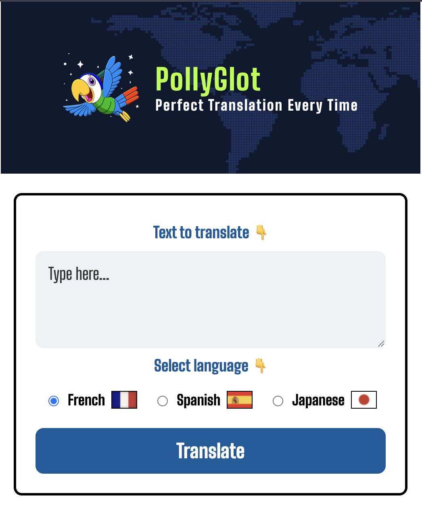
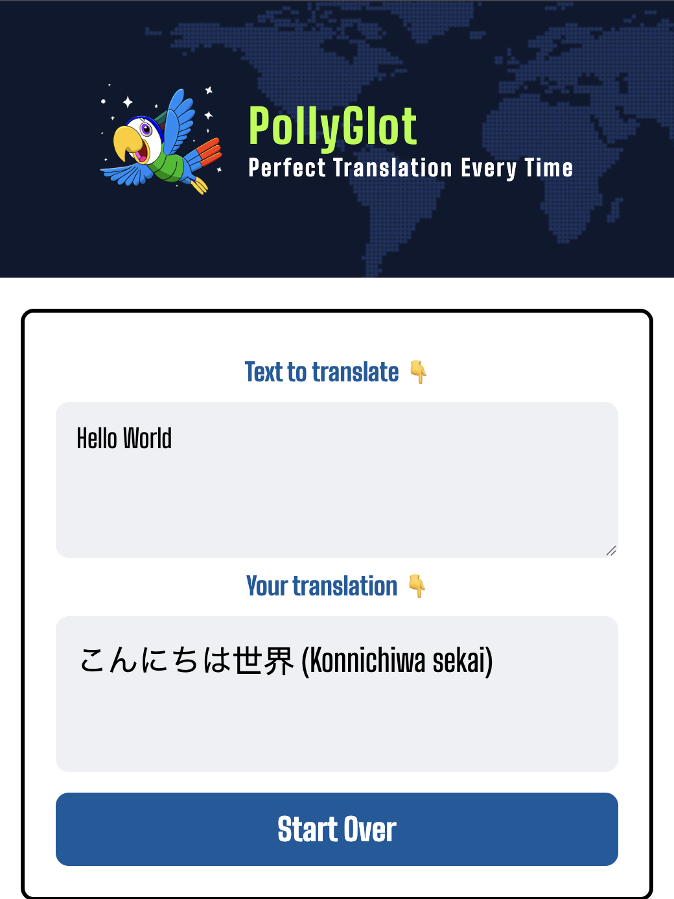

# PollyGlot — AI Translator App

A full-stack AI translation web app built with Express, vanilla JavaScript, and the OpenAI SDK. Enter any text, pick a target language (**French**, **Spanish**, or **Japanese** with romaji pronunciation), and get an instant translation.

## Preview

| Input & Language Selection | Translation Output |
| :---: | :---: |
|  |  |

## Features

- Translate text into **French**, **Spanish**, or **Japanese** (includes romaji pronunciation in parentheses)
- Express backend (`server.js`) keeps your API key private and serves the static frontend
- Responsive mobile-first UI with loading state and one-click **Start Over** reset

## Tech Stack

- **Frontend:** HTML, CSS, Vanilla JavaScript
- **Backend:** Node.js, Express
- **AI:** OpenAI Node SDK

## Getting Started

1. **Install dependencies**
   ```bash
   cd 10-pollyglot-ai-translator-app
   npm install
   ```

2. **Configure your API key**
   Ensure `../config.js` (copied from `../config.example.js`) has your `pollyGlot` credentials (`aiUrl`, `aiKey`, `aiModel`).

3. **Run the server**
   ```bash
   node --watch server.js
   ```

4. **Open in your browser**
   Visit `http://localhost:3000`.
