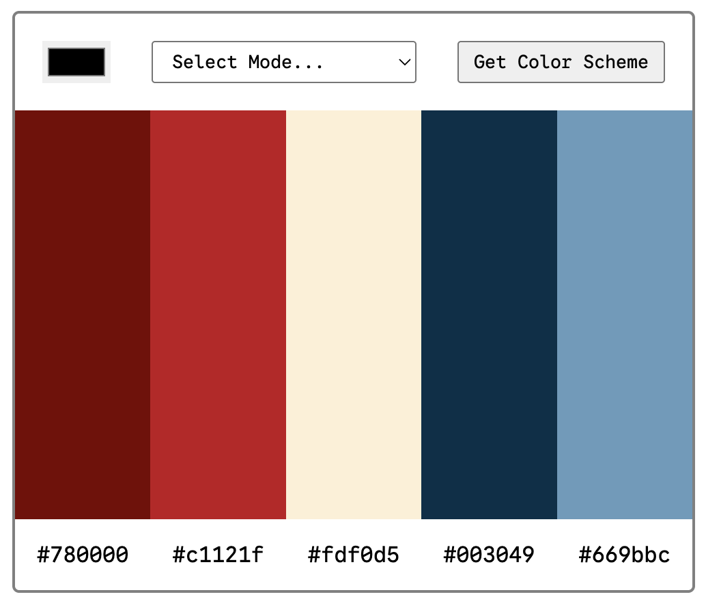
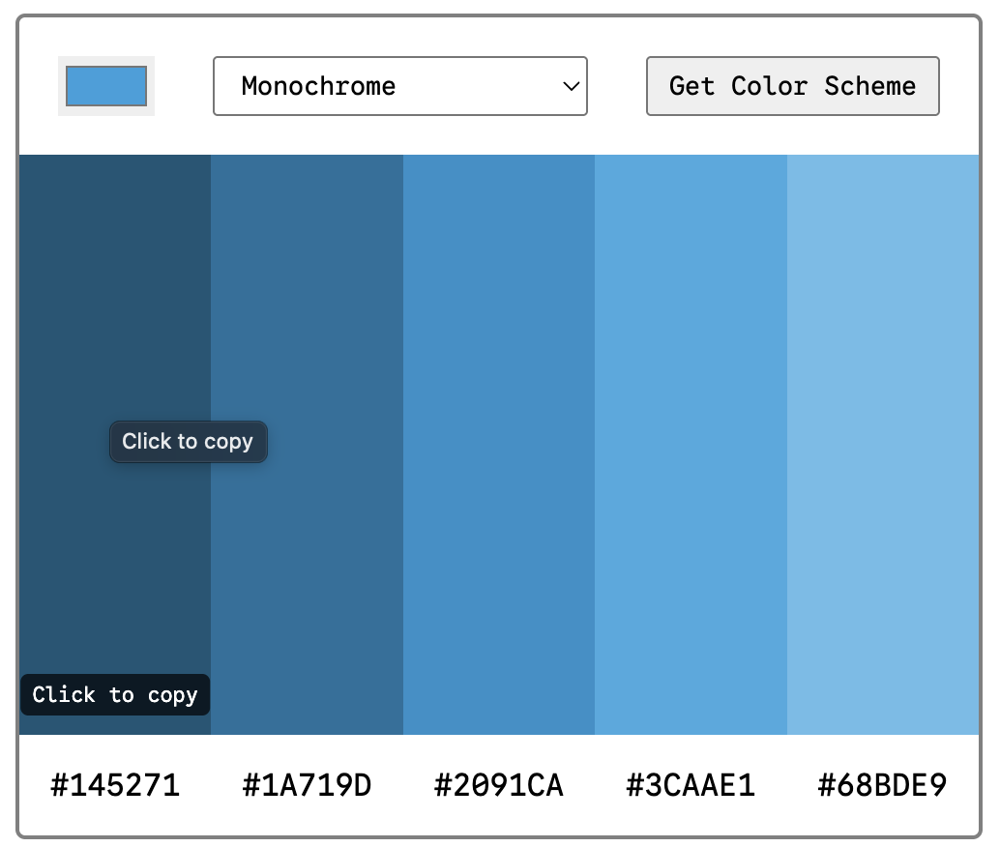

# Color Scheme Generator

A clean, interactive color scheme generator web app powered by [The Color API](https://www.thecolorapi.com/). Pick a seed color, choose a harmony mode, and click any color swatch or hex code to copy it to your clipboard.

## Screenshots

<div>
  <h2>Main View</h2>
  
  <h2>Color Generation & Click-to-Copy</h2>
  
</div>

## Features

- **Seed Color & Mode Selection**: Choose any base color with the native color picker and select from 7 scheme modes (`monochrome`, `monochrome-dark`, `analogic`, `complement`, `analogic-complement`, `triad`, `quad`).
- **Live API Integration**: Fetches 5 matching colors asynchronously from `https://www.thecolorapi.com/scheme`.
- **Click-to-Copy**: Click either a color swatch or its hex label to copy the hex code to the clipboard, with hover hints, smooth transitions, and `"Copied!"` confirmation feedback.

## Tech Stack

- HTML5
- CSS3 (Flexbox & Transitions)
- Vanilla JavaScript (`fetch`, `async/await`, Clipboard API)
- Google Fonts (`Google Sans Code`)
- [The Color API](https://www.thecolorapi.com/)

## Project Structure

```text
8-color-scheme-generator/
├── images/
│   ├── main.png
│   └── color-and-click-to-copy-feature.png
├── index.html
├── style.css
├── script.js
└── README.md
```

## Getting Started

1. Open `index.html` directly in your browser, or start a local development server:
   ```bash
   python3 -m http.server 8000
   ```
2. Open `http://localhost:8000` in your browser.
