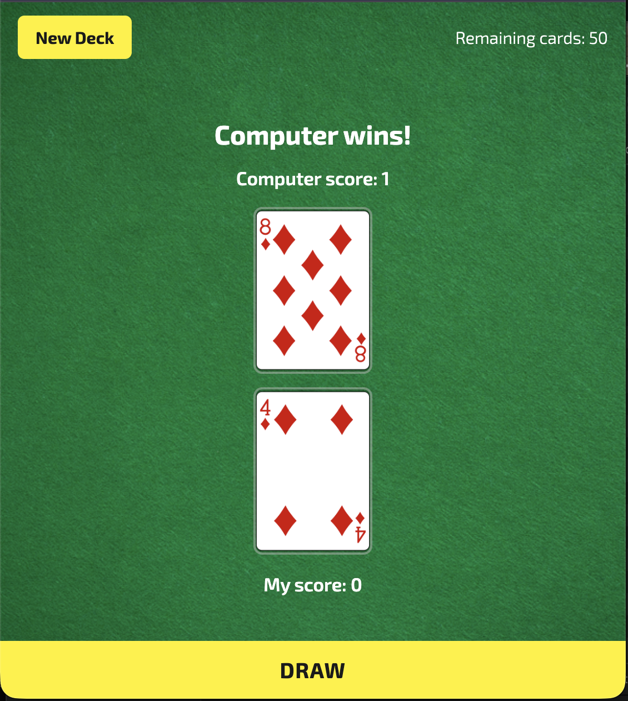

# Game of War



A responsive, mobile-first browser implementation of the classic **Game of War** card game built with vanilla HTML, CSS, and JavaScript using the [Deck of Cards API](https://apis.scrimba.com/deckofcards/api/deck/new/shuffle/).

## Overview

Draw cards head-to-head against the computer from a freshly shuffled 52-card deck. Each round draws two cards — one for the computer and one for you — compares their values (`2` through `Ace`), and awards a point to the higher card. When the deck runs out, the final winner is announced.

## Features

- **Mobile-first responsive layout**: Scales smoothly from mobile portrait and short landscape screens up to tablets and desktop monitors using `100dvh`, `aspect-ratio`, and `clamp()`.
- **Async/Await API integration**: Fetches shuffled decks and draws cards cleanly with `async`/`await`, HTTP status checks, and `try`/`catch`/`finally` error handling.
- **Safe game state management**:
  - Disables **Draw** until a deck is loaded and disables buttons while requests are in flight to prevent race conditions.
  - Clicking **New Deck** cleanly resets scores, card slots, header status, and remaining card count.
- **Accessible & SEO-ready**: Semantic landmarks (`<header>`, `<main>`, `<footer>`), `aria-live` announcements, descriptive card `alt` attributes, keyboard `:focus-visible` styles, and Open Graph / Twitter Card metadata.

## How to Play

1. Click **New Deck** to shuffle a fresh 52-card deck.
2. Click **Draw** to deal one card to the computer (top) and one card to yourself (bottom).
3. The higher card wins the round (`Ace` is high); equal values result in **War!** (no points awarded).
4. Continue drawing until all 52 cards are played to see the final winner, then click **New Deck** to play again.

## Tech Stack

- **HTML5** — Semantic markup and SEO metadata
- **CSS3** — Mobile-first Flexbox layout, responsive media queries, Google Fonts (`Exo 2`)
- **JavaScript (ES2020+)** — `async`/`await`, Fetch API, DOM manipulation
- **API** — Scrimba Deck of Cards API (`https://apis.scrimba.com/deckofcards/api/deck`)

## Project Structure

```text
8.1-game-of-war/
├── assets/
│   └── table.png       # Felt table background texture
├── images/
│   └── main.png        # UI preview screenshot
├── index.html          # App markup and SEO meta tags
├── index.css           # Mobile-first responsive styles
├── index.js            # Game logic and async API calls
└── README.md           # Project documentation
```

## Getting Started

No build step or dependencies are required.

1. Open `index.html` directly in your browser, **or**
2. Serve the folder with any local static server (e.g., VS Code Live Server or `npx serve .`).
