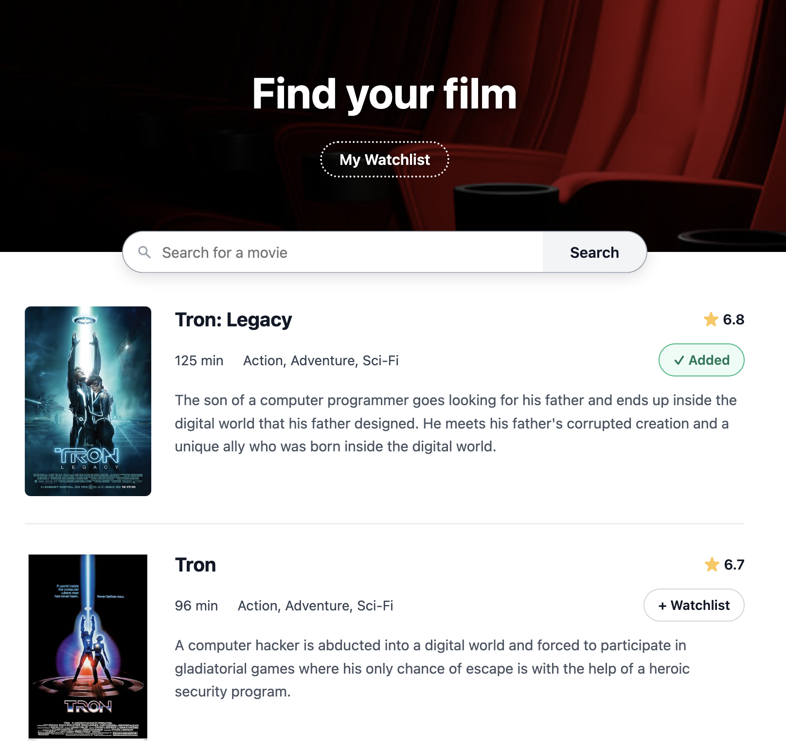
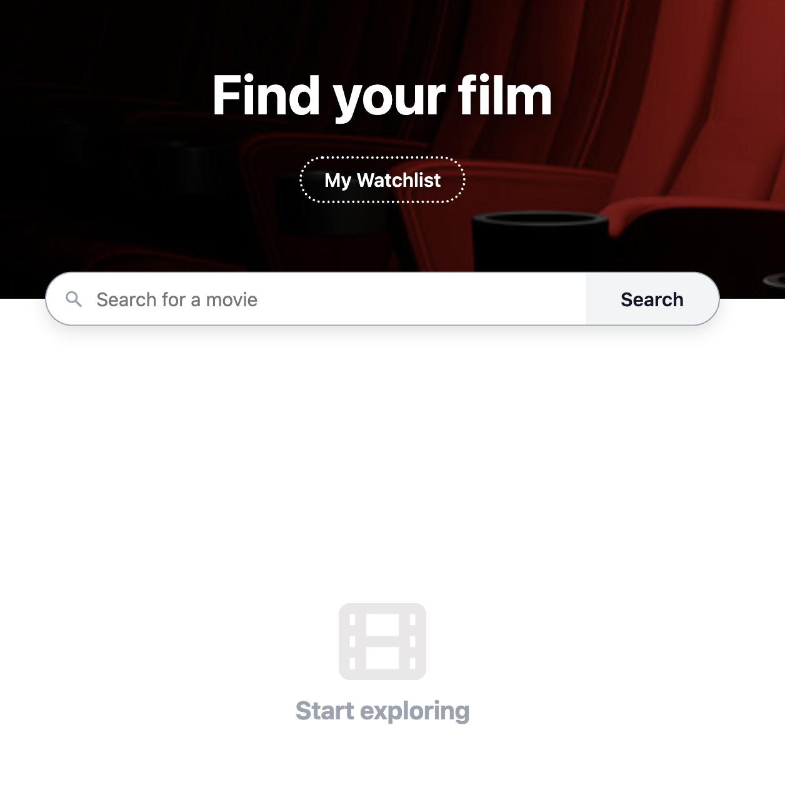
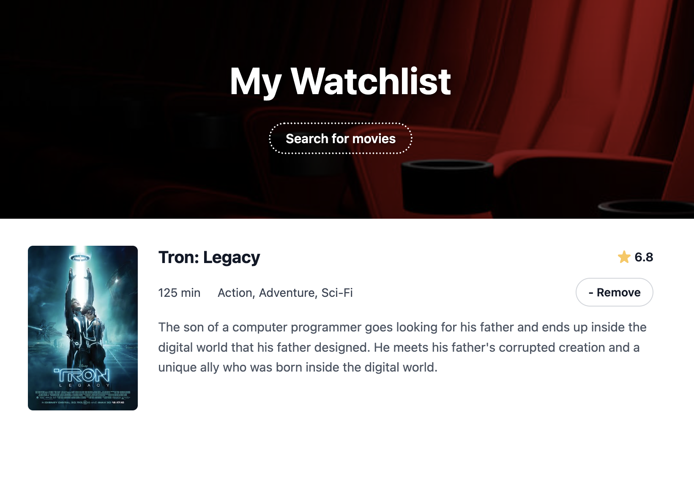

# Movie Watchlist

<p align="center">
  
</p>

A responsive movie search and personal watchlist web app built with vanilla HTML, CSS, and modular JavaScript using the [OMDb API](https://www.omdbapi.com/) and `localStorage`.

## Screenshots

| Home / Search | Search Results | My Watchlist |
| :---: | :---: | :---: |
|  |  |  |

## Overview

Search for movies by title, view rich details (poster, IMDb rating, runtime, genre, and plot summary), and save favorites to a persistent personal watchlist. Saved movies are stored in `localStorage` so they remain available across page reloads and browser sessions.

## Features

- **Two-step OMDb API integration**: Searches movies with `?s=` and fetches full movie details in parallel via `Promise.all()` using `?i=`.
- **Persistent Watchlist (`localStorage`)**: Add and remove movies cleanly with duplicate prevention and resilient JSON parsing in `storage.js`.
- **Instant UI feedback**: Shows loading (`Searching...`), empty/not-found states, fallback posters for `"N/A"` images, and updates `+ Watchlist` buttons to `✓ Added` for saved films.
- **Responsive across all devices**: Fluid typography and header sizing with `clamp()`, pill search bar, and stacked mobile cards (`<= 640px` and `<= 420px`) with touch-friendly buttons.
- **Modular ES6 architecture**: Separate modules for search (`script.js`), watchlist (`watchlist.js`), and shared persistence (`storage.js`), with API keys kept out of Git via `config.js`.

## Tech Stack

- **HTML5** — Semantic multi-page markup (`index.html`, `watchlist.html`)
- **CSS3** — Flexbox, responsive media queries, `clamp()`, `:has()` layout alignment
- **JavaScript (ES Modules)** — `async`/`await`, Fetch API, `Promise.all()`, `localStorage`, event delegation
- **API** — OMDb API (`https://www.omdbapi.com/`)

## Project Structure

```text
9-movie-watchlist/
├── assets/
│   ├── film-light.svg              # Empty state & fallback poster icon
│   ├── movie_banner.jpg            # Header background banner
│   ├── search.svg                  # Search input icon
│   └── star.svg                    # IMDb rating star icon
├── images/
│   ├── main-menu.png               # Home screen preview
│   ├── film-added-to-watchlist.png # Search results preview
│   └── watchlist-menu.png          # Watchlist page preview
├── index.html                      # Search page markup
├── watchlist.html                  # Watchlist page markup
├── index.css                       # Shared & responsive styles
├── watchlist.css                   # Watchlist-specific styles
├── script.js                       # Search, API calls & add-to-watchlist logic
├── watchlist.js                    # Watchlist rendering & removal logic
├── storage.js                      # localStorage helper module
└── README.md                       # Project documentation
```

## Getting Started

1. Get a free API key from [OMDb API](https://www.omdbapi.com/apikey.aspx) and activate it via email.
2. In the repository root, copy `config.example.js` to `config.js` and add your key:
   ```js
   export const CONFIG = {
       movieWatchlist: {
           apiKey: "YOUR_OMDB_API_KEY",
           apiUrl: "https://www.omdbapi.com/",
       },
   };
   ```
3. Serve the **repository root** with a local static server (e.g., VS Code Live Server or `npx serve .`) so ES module imports (`../config.js`) resolve properly, then open `/9-movie-watchlist/index.html`.
